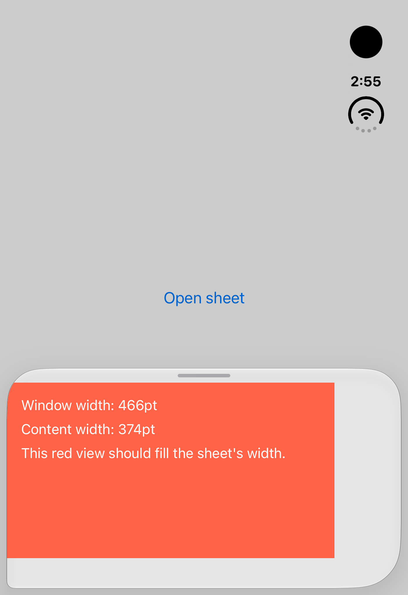

# @expo/ui BottomSheet: content stops short beside a side safe-area inset (iOS)

A minimal reproduction for `@expo/ui/community/bottom-sheet` on iOS. It's a blank SDK 58 app (`create-expo-app --template blank-typescript`) with `@expo/ui` added, and all of its code is in [`App.tsx`](App.tsx).

When the window has a horizontal safe-area inset on one side, the sheet runs edge to edge, but its React Native content stops short of that side by the inset's width. The folded iPhone Duo is one such window: its side rail is an ~84pt right inset.



## Run it

You need Xcode 27.1 or later, with the iPhone Duo simulator.

```bash
npm install
npx expo run:ios --device "iPhone Duo"
```

1. Make sure the simulator is folded (Simulator ▸ Device ▸ fold).
2. Tap **Open sheet**.

**Expected:** the red view fills the sheet's width.

**Actual:** the red view stops about 84pt short of the right edge. On screen, the window is 466pt wide and the content is 374pt wide.

## Cause

`BottomSheet.ios.tsx` gives the content's `Group` a fixed list of modifiers, and the window's safe area reaches the sheet's content. Adding `ignoreSafeArea({ edges: 'horizontal' })` to that `Group` makes the content fill the sheet. `BottomSheetProps` has no way to add modifiers, so an app can't apply that fix itself.
